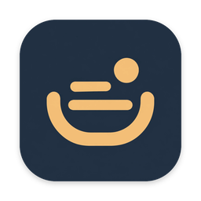
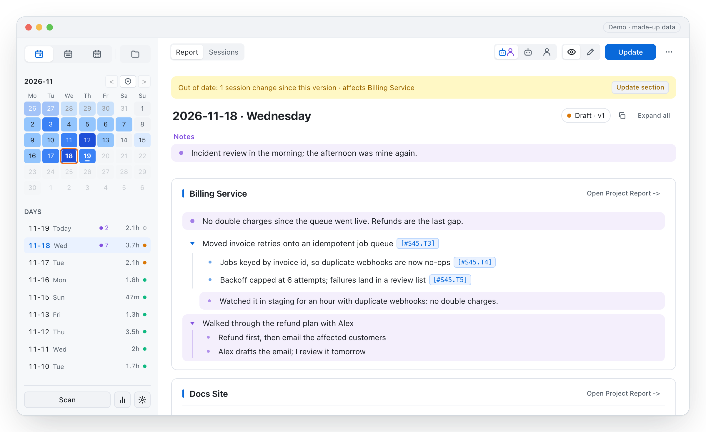
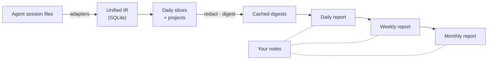

<div align="center">



# Lantai <sub><sup>兰台</sup></sub>

**Your agents keep the record. You keep the meaning.**

Lantai reads the sessions your agents leave on your machine and drafts daily, weekly and monthly reports,<br>
every point linked to its conversation. Beside them, you write what no session holds.

[](#license)
[](#get-started)
[](#architecture)
[](#versioning)

[Website](https://lantai.wohin.me) · [Get started](#get-started) · [Changelog](CHANGELOG.md) · [Design spec](docs/SPEC.md) · [Roadmap](docs/ROADMAP.md) · **English** | [简体中文](README.zh-CN.md)

</div>

> [!NOTE]
> **Lantai is in beta.** Until 1.0, an update may bring breaking changes, such as a new database format. The [changelog](CHANGELOG.md) lists them under **Breaking** with what to do. Before updating, you can back up everything in **Settings → System → Back up data**.

<br>

<p align="center">
  <picture>
    <source media="(prefers-color-scheme: dark)" srcset="docs/images/demo-dark.png">
    
  </picture>
  <br>
  <sub>The daily view, shown with made-up data. Try the <a href="https://lantai.wohin.me">interactive demo</a> on the website.</sub>
</p>

---

## Why

Much of our work now goes to agents. We explain the problem, an agent gets it done, and by evening the day's work lives in a dozen conversations. What changed, why, and where things got stuck are all in there, and almost none of it is in your commits.

But some of the day is in no session at all: the work you did elsewhere, whether things really worked out, what you made of it. Agents can produce excellent results for us. They can't live the day for us.

Lantai keeps both in one journal. The agent drafts; you write.

<p align="center">
  <picture>
    <source media="(prefers-color-scheme: dark)" srcset="docs/images/two-hands-dark.svg">
    
  </picture>
</p>

## Two hands, one journal

| The agent writes | You write |
| :--- | :--- |
| What happened in the sessions: what was built, what changed, where it got stuck | What happened outside them: the meeting, the test on a real phone, the decision made on a walk |
| Every point anchored to the turn it came from, checked by the program | Whether it worked, and what comes next |
| A fresh draft whenever you regenerate or update | Comments on any of the agent's points, and thoughts about the day |

Your writing lives in its own layer. Regenerating or updating a report never touches it; your edits to the agent's text are marked, and the original is a hover away. A switch shows both hands, only the agent's or only yours.

What you can write: a **note on the day**, a **note on a project** at the top or bottom of its section, a **comment** on one of the agent's points, and **project notes** for background and plans. Notes are an outline: nest them, fold them, drag them around.

## How it works

Writing the journal is meant to be a short evening ritual, not a one-click black box.

<table>
<tr>
<td width="33%" valign="top">

**① Gather**

Lantai reads each agent's session files incrementally and splits long sessions by day. You put the day's sessions into projects you created and ignore the noise; rules and the model suggest, you confirm.

</td>
<td width="33%" valign="top">

**② Draft**

Each session is condensed into a cached digest, and the model drafts the report by project: key points first, details and anchors below. Weekly and monthly reports build on the daily ones.

</td>
<td width="33%" valign="top">

**③ Write**

Add what only you know, right beside the draft: notes on the day and on projects, comments on the agent's points. You can write before anything is generated, too.

</td>
</tr>
</table>



## Features

<table>
<tr>
<td width="50%" valign="top">

### Two hands, one journal
The agent's draft and your notes share one page, one outline per project. Purple marks what you wrote; filter to see both, the agent's part, or only yours.

</td>
<td width="50%" valign="top">

### You sort, the model drafts
Projects are yours to define. Directory and remote rules or the model suggest where sessions belong, but nothing is filed until you accept. Move or ignore many sessions at once.

</td>
</tr>
<tr>
<td valign="top">

### Every point is traceable
Conclusions carry anchors like `[#S12.T5]` that open the exact turn they came from. Every anchor is validated by the program, and any the model made up is dropped.

</td>
<td valign="top">

### Your words survive every rewrite
Kept working after the report was written? **Update** rewrites only the projects that changed. Your notes are never touched, and your edits to the agent's text stay put and stay marked.

</td>
</tr>
<tr>
<td valign="top">

### Daily, weekly, monthly
Weekly reports cluster each project's week into a few threads of work; monthly reports build on the weekly ones. The project view rolls any project up by day, week or month, notes included.

</td>
<td valign="top">

### A dashboard of your work
Active hours with parallel sessions counted once, streaks, the kinds of tools your agents reach for, your hourly rhythm, and token usage by model with the cache hit rate.

</td>
</tr>
</table>

## Supported agents

| | Agent | Reads sessions from |
| :-: | :--- | :--- |
|  | **Claude Code** | `~/.claude/projects` |
|  | **Codex CLI** | `~/.codex/sessions`, `~/.codex/archived_sessions` |
|  | **Antigravity** | `~/.gemini/antigravity/brain`, `~/.gemini/antigravity-ide/brain` |
|  | **DeepSeek Harness** | `~/.dsh/sessions` |
|  | **WorkBuddy** | `~/.workbuddy/projects` |
|  | **OpenCode** | `~/.local/share/opencode/opencode.db` |

Each agent's log format is handled by its own adapter and parsed into one versioned intermediate representation, so everything above it works the same whichever agent you used. Claude Code is enabled by default. Turn the others on in **Settings → Agents**, which also shows whether each agent was detected on your machine and whether its local data is in a version Lantai reads. OpenCode is read from its 1.x storage; sessions stored by OpenCode 2.x are not read yet. Lantai copies OpenCode's database into its own cache before reading it, so nothing in OpenCode's directory is touched.

## Privacy

Agent logs hold private code, file paths and sometimes secrets. Lantai treats them that way.

| | |
| :--- | :--- |
| 🔒 **Read-only, always** | Lantai never writes, moves or deletes anything in your agents' data folders. Where those folders also hold credentials, it reads only the session files. |
| 🧹 **Redacted twice** | Keys, tokens, private-key blocks and `.env`-style values are scrubbed before anything reaches the local database, and again before any text is sent to a model. |
| 🔑 **Keys in the Keychain** | API keys live in the macOS Keychain, never in config files, the database or logs. Git remotes are stored as `host/owner/repo`, so tokens embedded in URLs are never kept. |
| 🧪 **Sealed generation** | The model writes reports with all tools disabled and nothing saved to disk. Instructions hidden inside a session are treated as plain text, never as commands. |
| 🖥️ **Your model, your choice** | Use any OpenAI-compatible endpoint, including local models through Ollama or LM Studio, so nothing has to leave your computer. Or reuse your Claude Code login. |
| 🚫 **No account, no telemetry** | No sign-up, no cloud sync, no analytics. Everything lives in a local SQLite database, and the session data in it can be rebuilt from your agents' logs at any time. |
| 🌐 **Online only when asked** | Besides your model, Lantai connects to nothing. Checking for updates is off unless you turn it on (or pick **Check for Updates…**); it then asks GitHub for the release list, sends only its version number, and never downloads anything. |

> [!NOTE]
> Reports are written by the model you configure. When that model is a hosted service, redacted session text is sent to its provider.

## Get started

**Requirements:** macOS 11 or later, on Apple silicon or Intel · a model: any OpenAI-compatible API, a local model server, or a signed-in [Claude Code](https://docs.anthropic.com/en/docs/claude-code).

### Desktop app

1. Download the `.dmg` from the [latest release](https://github.com/brant-ruan/lantai/releases/latest), open it and drag **Lantai** into **Applications**.
2. Open Lantai. It is not signed with an Apple Developer ID yet, so macOS blocks it the first time. Go to **System Settings → Privacy & Security**, find the message about Lantai and click **Open Anyway**. (Or run `xattr -dr com.apple.quarantine /Applications/Lantai.app` in a terminal.)

<details>
<summary><b>Build it from source instead</b></summary>

You need [Rust](https://rustup.rs) stable and [Node.js](https://nodejs.org).

```bash
git clone https://github.com/brant-ruan/lantai.git
cd lantai/app
npm install
npm run build:app        # produces build/Lantai.app
```

For development with hot reload, run `npm run tauri dev` instead.

</details>

### Your first report

1. **Choose agents.** Claude Code is on by default. To add others, open **Settings → Agents**; it shows which agents were found on your machine.
2. **Scan.** Click **Scan** in the sidebar. The first scan reads sessions from the last 90 days.
3. **Choose a model.** Open **Settings → Models**. If you use Claude Code, click **Find tools** and add it. Otherwise add a provider (see [Configure a model](#configure-a-model)).
4. **Sort the day.** Pick a day in the sidebar. Assign each session to a project from its row (**New project…** creates one), and **Ignore** what doesn't belong in a report. When you assign a session, Lantai offers a rule for its folder, so later sessions there are suggested or filed for you.
5. **Generate.** Click **Generate**, then add what only you know beside the draft.

### Good to know

- **Updates are manual for now.** Each new version is downloaded as a `.dmg` and, being unsigned, needs **Open Anyway** once more. Lantai can tell you when one is out: turn on update checks in **Settings → System**, or use **Check for Updates…** in the app menu.
- **Keys and the Keychain.** API keys are stored in your login Keychain under the service `lantai`, through macOS's own `security` tool. macOS does not normally ask for permission, and the keys survive updates.
- **Folder access.** Lantai reads each session's project folder only to find its Git repository (the `.git` folder). If your projects live in Documents, Desktop, Downloads or iCloud Drive, macOS asks once whether Lantai may access that folder. Saying no is fine: those sessions just can't be matched by repository rules.
- **Claude Code as the model.** `claude` must be installed and signed in. **Find tools** searches your login shell's `PATH`, so Lantai finds `claude` even when opened from Finder. It only runs `claude --version`; use **Test** to check sign-in. Codex CLI, Antigravity and OpenCode are found too, but cannot write reports yet: Lantai only uses a CLI that can run with every tool off and without leaving a session behind.

### Command line

The same engine ships inside the app as a command-line tool called `aj`. To use it in a terminal, open **Settings → System → Command-line tool** and click **Install**: this links `~/.local/bin/aj` to the app, with no administrator password. If `~/.local/bin` is not on your `PATH` yet, add this line to `~/.zshrc` and open a new terminal:

```bash
export PATH="$HOME/.local/bin:$PATH"
```

The first scan backfills the last 90 days.

```bash
aj scan              # ingest new sessions
aj sessions          # today's sessions, grouped by project
aj models --find     # agent CLIs on this Mac; `--add claude` makes Claude Code the model
aj report daily      # write today's report
```

<details>
<summary><b>All commands</b></summary>

```text
aj scan                          Scan sessions incrementally and ingest them
aj reslice                       Recompute daily slices after changing the day boundary
aj days                          List recent days that have activity
aj sessions [--date 2026-11-16]  List the slices of a day, grouped by project
aj show <session | S12>          Replay a session or slice in the terminal
aj digest S12                    Show what is sent to the model and the cached digest
aj search <terms...> [--layer reports|sessions] [--project ...] [--agent ...]   Search reports and session text
aj note <session> "text"         Attach a one-line note (highest priority in reports)
aj ignore | include <session>    Exclude a session from reports, or bring it back
aj project new <name> [--path dir] [--remote repo] [--regex re] [--auto]
aj project list | candidates | rename | describe | delete
aj rule list | add | rm | auto   Manage assignment rules (--auto files without asking)
aj accept [--date ...] [--all]   Accept assignment suggestions
aj assign <project|none> <session...>   Assign by hand; target S12 to change one day only
aj unassign <session...>         Remove a manual assignment
aj report daily   [--date ...]  [--update] [--prompt name] [--model alias] [--dry-run]
aj report weekly  [--week 2026-W47 | --date ...] [--update]
aj report monthly [--month 2026-11 | --date ...] [--update]
aj report history | show         List and print saved report versions
aj prompt list | show | new | edit | rename | delete | default
aj export [--session <prefix>]   Export sessions in the IR exchange format
aj models [--test] [--find]      List model aliases, test them, or find agent CLIs (--add claude)
aj doctor                        Show the parsing health of each source
```

Run `aj <command> --help` for every option.

</details>

### Configure a model

Open **Settings → Models** in the app: click **Find tools** to add Claude Code, or add a provider (base URL and key), fetch its model list, give the models you use an alias and pick a default. Keys go to the macOS Keychain. The first model you add becomes the default.

<details>
<summary><b>Or edit <code>config.toml</code> by hand</b></summary>

The file lives in the data directory (`~/Library/Application Support/lantai` on macOS; override with `--data-dir` or `AJ_DATA_DIR`). Without it, no model is set up.

```toml
default_model = "local"            # alias used when none is chosen

[providers.ollama]                 # any OpenAI-compatible endpoint
type = "openai_compat"
base_url = "http://localhost:11434/v1"

[models.local]                     # alias = provider + model id + options
provider = "ollama"
model = "qwen3:32b"
# reasoning_effort = "high"        # optional; values depend on the server

[providers.claude]                 # the Claude Code CLI (what Find tools adds)
type = "claude_cli"
binary = "/Users/you/.local/bin/claude"

[models."Claude Code"]             # no model id: the CLI's own default
provider = "claude"

[agents.codex]                     # which agents to scan (default: Claude Code only)
enabled = true

[slicing]
day_boundary_hour = 0              # 0–12; work before this hour counts towards the previous day

[budgets]                          # character budgets; tune to your model's context window
chunk_chars = 40000                # longest record in one digest request
stage2_chars = 60000               # most material in one report request
```

The full reference is at the top of [`crates/aj-report/src/config.rs`](crates/aj-report/src/config.rs).

</details>

### Shape the prompts

The prompt decides a report's structure, length and tone. Built-in prompts for daily, weekly and monthly reports can be edited in **Settings → Prompts**, or kept as several variants on the command line (`aj prompt new mine --from standard`, then `aj prompt default mine`). Anchor rules and the "stick to the material" instructions are appended by the program, so editing a prompt can't break traceability. Every report version saves the prompt it was written with, and because digests are cached, trying a new prompt costs a single model call.

### Your data

Everything lives in `~/Library/Application Support/lantai`: the database `journal.sqlite`, the settings `config.toml` and a cache. Sessions in the database can always be rebuilt from your agents' logs; your projects, rules, prompts, reports, edits and notes exist only there.

- **Back up and restore** in **Settings → System**. A backup is one zip file with the database and settings; API keys stay in the Keychain and are not included. Restoring first keeps a copy of what it replaces.
- **Updating during the beta:** read the release's **Breaking** section first. When a new version changes the database format, Lantai keeps a copy of the old database next to it (`journal.sqlite.bak-schema-<n>`) before migrating.
- **Uninstalling:** delete the app, the folder above and `~/.local/bin/aj` if you installed the command-line tool, and remove the `lantai` items in Keychain Access.
- **Getting the data out:** reports export as Markdown; `aj export` writes the sessions in the exchange format of Lantai's versioned intermediate representation (JSON lines), described in [docs/SPEC.md](docs/SPEC.md).

## Architecture

Lantai is a Rust workspace with a thin Tauri + React shell. Each agent's format knowledge stays inside its adapter; everything above works on the versioned IR.

```text
crates/
  aj-ir                 IR types and version, agent identifiers, exchange format (no I/O)
  aj-adapter            SourceAdapter trait, streaming and zstd readers
  aj-adapter-*          one adapter per agent: claude, codex, antigravity, dsh, workbuddy, opencode
  aj-sources            registry: agent → session folders → adapter
  aj-store              SQLite persistence and stats queries
  aj-core               scanning, per-day slicing, redaction, project rules, stats
  aj-report             digests, reports, engines, anchor validation, versions, export
  aj-backup             backup archives
  aj-update             update check against GitHub Releases
  aj-cli                the `aj` command
app/                    Tauri v2 desktop app (React + TypeScript)
website/                lantai.wohin.me, plain static HTML
```

Dependencies point one way: `aj-ir` ← adapters / `aj-store` ← `aj-core` ← `aj-report` ← `aj-cli` / `app`.

Documentation:

- [docs/SPEC.md](docs/SPEC.md): the design, including the IR, storage, the report pipeline and privacy
- [docs/ADAPTERS.md](docs/ADAPTERS.md): each agent's session format, and how to add an adapter
- [docs/ROADMAP.md](docs/ROADMAP.md): what comes next, and what was set aside and why
- [docs/RELEASING.md](docs/RELEASING.md): versioning and releases

## Versioning

Lantai follows [Semantic Versioning](https://semver.org). Until `1.0.0`, a minor release may contain breaking changes, such as a database schema change; the [changelog](CHANGELOG.md) always lists them under **Breaking** and says what to do. Releases are tagged `vX.Y.Z`. See [docs/RELEASING.md](docs/RELEASING.md) for the policy and release steps.

## Why I built it

Agents can produce excellent results for us, but they can't live the day for us. A record of this new way of working may be of little use to the agents, and of little use to the projects. But to us, as people, it matters. Looking back over the days, weeks and months, you see how much you got done working alongside agents, including things you never thought you could do. That meaning is yours.

Lantai is also an experiment in how people and agents work together, and how they keep a record together. If you have thoughts on where the line should be, [start a discussion](https://github.com/brant-ruan/lantai/discussions).

**Why "Lantai"?** Lantai (兰台) was where the Han dynasty court kept its books and archives; the historian Ban Gu worked there, collating texts and compiling the history of his age. *Lan* (兰) is the orchid: quiet and understated, with a fragrance of its own. Gathering each day's scattered work, putting it in order and filing it away is exactly what this app sets out to do.

## Contributing

Issues and pull requests are welcome, with one caveat: for now I'm focused on the existing [roadmap](docs/ROADMAP.md), so I can't promise a timely review or that a pull request will be merged. Before you start:

- **Bugs** go in [issues](https://github.com/brant-ruan/lantai/issues), **ideas and questions** in [Discussions](https://github.com/brant-ruan/lantai/discussions), and **privacy or security problems** go privately through [SECURITY.md](SECURITY.md). Please don't paste session content, reports or keys: issues are public.
- For anything larger than a small fix, start a discussion first, so we can agree it fits before you put in the work.
- [AGENTS.md](AGENTS.md) describes the conventions and hard constraints (read-only sources, privacy rules, layering). It is written for coding agents and works just as well for people. [docs/SPEC.md](docs/SPEC.md) is the single source of truth for the design; change it before changing behavior. To support another agent, start with [docs/ADAPTERS.md](docs/ADAPTERS.md).
- Run `cargo fmt --all`, `cargo clippy --workspace --all-targets` and `cargo test --workspace` before sending a change. Never commit real session content: fixtures must be redacted.

## Sponsor

Lantai is free and open source. If it helps you keep a record of your work, you can support its development through [GitHub Sponsors](https://github.com/sponsors/brant-ruan) or [Afdian](https://afdian.com/a/bonan) (WeChat Pay and Alipay, any amount).

## License

Licensed under either of [MIT](LICENSE-MIT) or [Apache-2.0](LICENSE-APACHE), at your option. Unless you explicitly state otherwise, any contribution you intentionally submit for inclusion in this project, as defined in the Apache-2.0 license, shall be dual licensed as above, without any additional terms or conditions.

<br>

<div align="center">
<sub>Claude Code, Codex CLI, Antigravity, DeepSeek Harness, WorkBuddy and OpenCode are the property of their respective owners; Lantai is not affiliated with them. Agent icons from <a href="website/assets/agents/LICENSE">Lobe Icons</a> (MIT).</sub>
</div>
