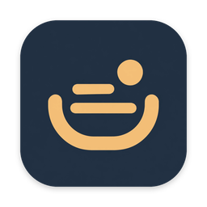
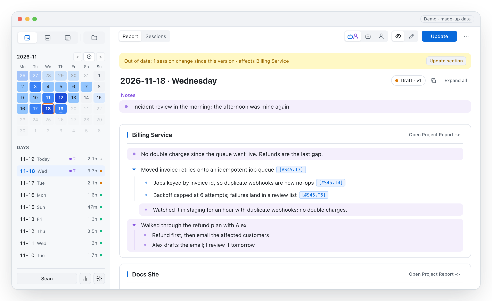
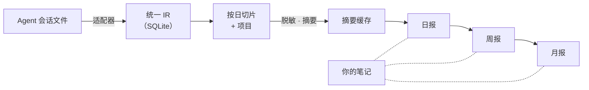

<div align="center">



# 兰台 <sub><sup>Lantai</sup></sub>

**Agent 记下过程，你写下意义。**

兰台读取 Agent 留在本机的会话，起草日报、周报和月报，每条结论都能追溯到原始对话。<br>
在它旁边，你写下会话里没有的东西。

[](#许可)
[](#开始使用)
[](#架构)
[](#版本)

[主页](https://lantai.wohin.me/zh/) · [开始使用](#开始使用) · [更新日志](CHANGELOG.md) · [设计文档](docs/SPEC.md) · [路线图](docs/ROADMAP.md) · [English](README.md) | **简体中文**

</div>

> [!NOTE]
> **兰台目前处于 beta 阶段。** 1.0 之前，更新可能带来不兼容的变化，例如新的数据库格式。[更新日志](CHANGELOG.md)会把它们列在 **Breaking** 下并写明该怎么做。更新之前，可以在 **设置 → 系统 → 备份数据** 里备份全部数据。

<br>

<p align="center">
  <picture>
    <source media="(prefers-color-scheme: dark)" srcset="docs/images/demo-dark.png">
    
  </picture>
  <br>
  <sub>日报视图，数据均为虚构。主页上有<a href="https://lantai.wohin.me/zh/">可以操作的演示</a>。</sub>
</p>

---

## 为什么

如今许多工作都交给了 Agent。把问题说清楚，Agent 把事情做完，一天的工作就散落在十几个会话里。改了什么、为什么改、在哪里卡住，都在对话里，提交记录里几乎没有。

但这一天还有一部分不在任何会话里：会话之外做的事，事情最后成没成，自己怎么看这一天。Agent 能替我们做出很好的结果，却没法替我们度过这一天。

兰台把两者放进同一份日志：Agent 起草，你落笔。

<p align="center">
  <picture>
    <source media="(prefers-color-scheme: dark)" srcset="docs/images/two-hands-dark.svg">
    
  </picture>
</p>

## 两种笔迹，一份日志

| Agent 写 | 你写 |
| :--- | :--- |
| 会话里发生了什么：做了什么、改了哪里、在哪里卡住 | 会话之外发生了什么：一场讨论、在真机上的测试、散步时做的决定 |
| 每条结论都锚定到原始轮次，由程序校验 | 事情成没成，下一步做什么 |
| 每次重新生成或更新，都是一份新的草稿 | 对 Agent 某条要点的批注，以及当天的体会 |

你写的内容单独存放，重新生成或更新报告都不会碰它；你改过的 Agent 原文会被标出来，悬停即可看到原文。一个开关就能切换：两者并排、只看 Agent、只看你写的。

能写的有：当天的**随记**、项目小节顶部或底部的**手记**、挂在 Agent 要点上的**批注**，以及写背景和计划的**项目笔记**。笔记是大纲，可以嵌套、折叠、拖动。

## 工作方式

整理日志应该是每晚几分钟的小仪式，而不是一键生成的黑箱。

<table>
<tr>
<td width="33%" valign="top">

**① 收拢**

兰台增量读取各个 Agent 的会话文件，按天切分长会话。你把当天的会话放进自己建好的项目，忽略无关的；规则和模型给出建议，由你确认。

</td>
<td width="33%" valign="top">

**② 起草**

每个会话先压缩成带缓存的摘要，模型再按项目起草报告：核心结论在前，细节与锚点在后。周报和月报在日报的基础上汇总。

</td>
<td width="33%" valign="top">

**③ 落笔**

在草稿旁边写下只有你知道的事：当天与项目的笔记、对 Agent 要点的批注。还没生成报告时，也可以先写。

</td>
</tr>
</table>



## 功能

<table>
<tr>
<td width="50%" valign="top">

### 两种笔迹，一份日志
Agent 的草稿和你的笔记在同一页上，每个项目一份大纲。紫色是你写的；可以切换为两者并排、只看 Agent 或只看你写的。

</td>
<td width="50%" valign="top">

### 你来归类，模型起草
项目由你定义。目录、远程仓库规则或模型会建议会话的归属，但在你接受之前不会归入。可以批量移动或忽略会话。

</td>
</tr>
<tr>
<td valign="top">

### 每条结论都可追溯
结论带有 `[#S12.T5]` 这样的锚点，点开就是它出自的那一轮对话。每个锚点都由程序校验，模型编造的会被剔除。

</td>
<td valign="top">

### 你写的字经得起每一次重写
报告写完后又接着干活了？**Update** 只重写有变化的项目。你的笔记永远不会被改动，你改过的 Agent 原文也原样保留，并带有修订标记。

</td>
</tr>
<tr>
<td valign="top">

### 日报、周报、月报
周报把每个项目一周的工作归纳成几条主线，月报在周报的基础上汇总。项目视图可以按日、周、月汇总任意项目，笔记也在其中。

</td>
<td valign="top">

### 工作统计看板
活跃时长（并行会话只算一次）、连续天数、Agent 常用的工具类型、一天中的工作节奏，以及按模型统计的 Token 用量和缓存命中率。

</td>
</tr>
</table>

## 支持的 Agent

| | Agent | 会话读取位置 |
| :-: | :--- | :--- |
|  | **Claude Code** | `~/.claude/projects` |
|  | **Codex CLI** | `~/.codex/sessions`、`~/.codex/archived_sessions` |
|  | **Antigravity** | `~/.gemini/antigravity/brain`、`~/.gemini/antigravity-ide/brain` |
|  | **DeepSeek Harness** | `~/.dsh/sessions` |
|  | **WorkBuddy** | `~/.workbuddy/projects` |
|  | **OpenCode** | `~/.local/share/opencode/opencode.db` |

每个 Agent 的日志格式由各自的适配器处理，解析成同一套有版本的中间表示，之上的一切与用的是哪个 Agent 无关。默认只启用 Claude Code。其他 Agent 在「设置 → Agent」里开启，那里也会显示本机是否检测到对应的会话目录，以及本机数据的版本兰台能否读取。OpenCode 目前读取 1.x 的存储，OpenCode 2.x 保存的会话暂不读取；兰台会先把 OpenCode 的数据库复制到自己的缓存目录再读，不会改动 OpenCode 目录里的任何文件。

## 隐私

Agent 日志里有私有代码、文件路径，有时还有密钥。兰台按这个标准对待它们。

| | |
| :--- | :--- |
| 🔒 **始终只读** | 兰台从不写入、移动或删除 Agent 数据目录里的任何文件。这些目录里如果还有凭据，它只读会话部分。 |
| 🧹 **两次脱敏** | 密钥、令牌、私钥块和 `.env` 一类的值，在写入本地数据库前清除一次，发给模型前再清除一次。 |
| 🔑 **密钥存在钥匙串** | API 密钥存在 macOS 钥匙串里，不进配置文件、数据库或日志。Git 远程地址只记 `host/owner/repo`，内嵌的令牌不保留。 |
| 🧪 **封闭生成** | 模型写报告时，所有能执行命令、修改文件或联网的工具都已关闭，也不保存会话。会话里夹带的指令只被当作文字，不会被执行。[各 Agent 命令行还剩哪些工具声明](#用-agent-命令行当模型)。 |
| 🖥️ **模型由你选** | 可用任何 OpenAI 兼容接口，包括 Ollama 或 LM Studio 运行的本地模型，数据不出电脑；也可以沿用已登录的 Claude Code 或 Codex。 |
| 🚫 **无账号，无遥测** | 不用注册，没有云同步，也不做统计上报。所有内容都在本地 SQLite 数据库里，其中的会话数据随时可以从 Agent 日志重建。 |
| 🌐 **只在你要求时联网** | 除了你配置的模型，兰台不连接任何地方。检查更新默认关闭，开启后（或点菜单「检查更新…」时）只向 GitHub 查询发布列表，只发送自己的版本号，从不下载任何东西。 |

> [!NOTE]
> 报告由你配置的模型撰写。如果使用的是在线模型服务，脱敏后的会话文本会发送给该服务的提供方。

## 开始使用

**需要：** macOS 11 或更新版本，Apple 芯片或 Intel 均可 · 一个模型：OpenAI 兼容接口、本地模型，或已登录的 [Claude Code](https://docs.anthropic.com/en/docs/claude-code)。

### 桌面应用

1. 从[最新发布](https://github.com/brant-ruan/lantai/releases/latest)下载 `.dmg`，打开后把 **Lantai** 拖进「应用程序」。
2. 打开兰台。它还没有苹果开发者签名，macOS 第一次会拦下它：打开「系统设置 → 隐私与安全性」，找到关于兰台的提示，点「仍要打开」。（也可以在终端里执行 `xattr -dr com.apple.quarantine /Applications/Lantai.app`。）

<details>
<summary><b>或者从源码构建</b></summary>

需要 [Rust](https://rustup.rs)（stable）与 [Node.js](https://nodejs.org)。

```bash
git clone https://github.com/brant-ruan/lantai.git
cd lantai/app
npm install
npm run build:app        # 生成 build/Lantai.app
```

开发调试（热更新）用 `npm run tauri dev`。

</details>

### 第一份日报

1. **选择 Agent。** 默认只读 Claude Code。要加入其他 Agent，打开「设置 → Agent」，这里会显示本机检测到了哪些。
2. **扫描。** 点侧栏的「扫描」。第一次扫描读取最近 90 天的会话。
3. **选择模型。** 打开「设置 → 模型」。如果你在用 Claude Code 或 Codex CLI，点「查找本机工具」把它添加进来；否则添加一个提供方（见[配置模型](#配置模型)）。
4. **整理当天。** 在侧栏选一天，从每条会话所在的行把它归到项目里（「新建项目…」可以新建），不该进报告的点「忽略」。归属会话时，兰台会提议为它所在的文件夹建一条规则，以后这个文件夹里的会话会被建议或自动归属。
5. **生成。** 点「生成」，然后在草稿旁边写下只有你知道的事。

### 注意事项

- **暂时需要手动更新。** 每个新版本都要重新下载 `.dmg`；因为没有签名，第一次打开时还要再点一次「仍要打开」。兰台可以在新版本发布时提醒你：在「设置 → 系统」里打开检查更新，或者点应用菜单里的「检查更新…」。
- **密钥与钥匙串。** API 密钥通过 macOS 自带的 `security` 工具存进登录钥匙串，服务名为 `lantai`。系统通常不会弹窗询问，更新应用后密钥也仍然有效。
- **文件夹访问。** 兰台读取每个会话的项目文件夹，只是为了找到它的 Git 仓库（`.git` 文件夹）。如果你的项目放在「文稿」「桌面」「下载」或 iCloud 云盘里，macOS 会询问一次是否允许兰台访问该文件夹。拒绝也没关系，只是这些会话无法按仓库规则归属。
- **用 Agent 命令行当模型。** 需要已安装并登录 `claude` 或 `codex`。「查找本机工具」会搜索登录 shell 的 `PATH`，所以从访达打开也能找到它们。查找只运行 `--version`，是否已登录请用「测试」确认。Antigravity 和 OpenCode 也能被找到，但暂时不能用来写报告（见[用 Agent 命令行当模型](#用-agent-命令行当模型)）。

### 命令行

同一套引擎的命令行版本叫 `aj`，随应用一起提供。要在终端里使用，打开「设置 → 系统 → 命令行工具」点「安装」：它会把 `~/.local/bin/aj` 链接到应用里，不需要管理员密码。如果 `~/.local/bin` 还不在你的 `PATH` 里，把下面这行加进 `~/.zshrc`，然后打开新的终端窗口：

```bash
export PATH="$HOME/.local/bin:$PATH"
```

首次扫描回填最近 90 天。

```bash
aj scan              # 增量扫描并入库
aj sessions          # 当天的会话，按项目分组
aj models --find     # 本机的 Agent 命令行；`--add claude` 或 `--add codex` 添加一个
aj report daily      # 生成当天的日报
```

<details>
<summary><b>全部命令</b></summary>

```text
aj scan                          增量扫描会话并入库
aj reslice                       修改日界线后重新切分所有会话
aj days                          列出最近有活动的日期
aj sessions [--date 2026-11-16]  列出某一天的会话切片，按项目分组
aj show <会话 | S12>              在终端回放会话或切片
aj digest S12                    查看送给模型的文本和已缓存的摘要
aj search <词...> [--layer reports|sessions] [--project ...] [--agent ...]   搜索报告与会话原文
aj note <会话> "一句话"           补充备注，生成报告时优先级最高
aj ignore | include <会话>        在报告中忽略某个会话，或恢复
aj project new <名称> [--path 目录] [--remote 仓库] [--regex 正则] [--auto]
aj project list | candidates | rename | describe | delete
aj rule list | add | rm | auto   管理归属规则（--auto 命中后直接归属，否则只给建议）
aj accept [--date ...] [--all]   接受归属建议
aj assign <项目|none> <会话...>   人工指定归属；目标写 S12 则只改那一天
aj unassign <会话...>             撤销人工归属
aj report daily   [--date ...]  [--update] [--prompt 名称] [--model 别名] [--dry-run]
aj report weekly  [--week 2026-W47 | --date ...] [--update]
aj report monthly [--month 2026-11 | --date ...] [--update]
aj report history | show         查看报告的各个版本
aj prompt list | show | new | edit | rename | delete | default
aj export [--session <前缀>]      以 IR 交换格式导出会话
aj models [--test] [--find]      列出模型别名、测试连通性，或查找本机 Agent 命令行（--add claude|codex）
aj migrate                       备份并升级旧版兰台留下的数据
aj doctor                        查看各数据源的解析状态
```

每个命令的完整参数见 `aj <命令> --help`。

</details>

### 配置模型

在应用的「设置 → 模型」里配置：点「查找本机工具」添加 Claude Code 或 Codex CLI，或者添加提供方（地址与密钥），拉取模型列表，为常用模型建别名并选定默认。密钥保存在 macOS 钥匙串。第一个添加的模型会成为默认模型。

每个别名都可以设置推理强度，OpenAI 兼容接口的别名还可以设置温度（0～2）；留空则不发送，使用提供方的默认值。Agent 命令行也能拉取模型列表：Claude Code 给出简写（`fable`、`opus`、`sonnet`、`haiku`）和各档推理强度，Codex 列出它的模型选择器里的模型以及每个模型支持的推理强度。Agent 命令行都没有温度设置。

<details>
<summary><b>也可以直接编辑 <code>config.toml</code></b></summary>

文件在数据目录下（macOS 上是 `~/Library/Application Support/lantai`，可用 `--data-dir` 或 `AJ_DATA_DIR` 修改）。没有这个文件时，不会配置任何模型。

```toml
default_model = "local"            # 未指定模型时使用的别名

[providers.ollama]                 # 任意 OpenAI 兼容接口
type = "openai_compat"
base_url = "http://localhost:11434/v1"

[models.local]                     # 别名 = 提供方 + 模型 id + 选项
provider = "ollama"
model = "qwen3:32b"
# reasoning_effort = "high"        # 可选，取值由服务端决定
# temperature = 0.3                # 可选，0～2；只用于 OpenAI 兼容接口

[providers.claude]                 # Claude Code 命令行（「查找本机工具」添加的）
type = "claude_cli"                # Codex CLI 写 "codex_cli"
binary = "/Users/you/.local/bin/claude"

[models."Claude Code"]             # 不写模型 id：用命令行自己的默认模型
provider = "claude"
# reasoning_effort = "high"        # 可选：low、medium、high、xhigh 或 max

[agents.codex]                     # 扫描哪些 Agent（默认只有 Claude Code）
enabled = true

[slicing]
day_boundary_hour = 0              # 0～12；这个时间之前的工作算作前一天

[budgets]                          # 字符数上限，按所用模型的上下文调整
chunk_chars = 40000                # 单次摘要请求的上限
stage2_chars = 60000               # 单次报告请求的素材上限
```

完整说明见 [`crates/aj-report/src/config/mod.rs`](crates/aj-report/src/config/mod.rs) 顶部的注释。

</details>

### 用 Agent 命令行当模型

兰台可以借用你已经付费的 Agent 命令行来写报告。并不是每个命令行都能关掉全部工具，所以兰台对每个命令行都用它允许的最少工具来运行，并且只在调用不留下会话、剩下的东西都不能执行命令、修改文件或联网时才使用它。以下是 2026 年 11 月的检查结果：

| 命令行 | 版本 | 兰台的运行方式 | 仍然声明的工具 | 会话 |
| :--- | :--- | :--- | :--- | :--- |
| Claude Code | 2.1 | `claude -p --tools ""` | 无 | 不保存 |
| Codex CLI | 0.160 | `codex exec --ephemeral`，关闭 22 项功能，只读沙箱，从不批准 | Codex 的默认模型：`exec`（调用会失败，它的宿主已关闭）、`wait`、`request_user_input_async`。其他模型：`apply_patch`（被只读沙箱拦住）。 | 不保存 |
| Antigravity | 1.4 | 不使用：工具关不掉 | | 保留 |
| OpenCode | 1.18 | 不使用：每次运行都会保存 | | 保留 |

使用 Codex 时，请求里仍会带上你的全局 `~/.codex/AGENTS.md` 和 Codex 的技能列表，而 `~/.codex/config.toml` 会被忽略（其中的 MCP 服务器、配置档和自定义提供方都不生效）。如果 Codex 更新后改了兰台要关闭的某项功能的名字，生成会带着 Codex 的报错停下，而不是在那个工具重新打开的情况下继续运行；这时请更新兰台。具体命令见 [docs/SPEC.md](docs/SPEC.md#agent-clis)。

### 打磨提示词

提示词决定报告的结构、详略和语气。日报、周报、月报的内置提示词可以在「设置 → 提示词」里直接修改，也可以在命令行保存多份对照（`aj prompt new mine --from standard`，再 `aj prompt default mine`）。锚点格式、只依据素材等规则由程序固定追加，改提示词不会破坏溯源。每个报告版本都记录生成它所用的提示词；摘要有缓存，换提示词重新生成只需要一次模型调用。

### 你的数据

所有数据都在 `~/Library/Application Support/lantai`：数据库 `journal.sqlite`、设置 `config.toml` 和缓存。数据库里的会话随时可以从各 Agent 的日志重建；你的项目、规则、提示词、报告、修改和笔记只存在这里。

- **备份与恢复**在「设置 → 系统」里。备份是一个 zip 文件，包含数据库和设置；API 密钥留在钥匙串里，不在备份中。恢复之前会先保留一份被替换的数据。
- **beta 期间的更新：**先看该版本的 **Breaking** 部分。新版本改变数据库格式时，兰台会先征求你的同意再升级数据，并在升级前把数据库和设置备份到上述文件夹的 `backups/` 里（与手动备份相同的 zip 文件），也可以另选文件夹。想回到旧版本时，在旧版里恢复这份备份即可。命令行下用 `aj migrate` 完成同样的事。
- **卸载：**删除应用和上面的文件夹；如果装了命令行工具，再删除 `~/.local/bin/aj`；最后在「钥匙串访问」里删除 `lantai` 条目。
- **导出数据：**报告可以导出为 Markdown；`aj export` 按兰台中间表示的交换格式（每行一个 JSON）导出会话，格式带版本号，见 [docs/SPEC.md](docs/SPEC.md)。

## 架构

兰台是一个 Rust workspace，外加一层很薄的 Tauri + React 外壳。各家 Agent 的格式知识只留在各自的适配器里，之上的一切都基于有版本的 IR。各 crate 的职责与依赖关系见 [docs/SPEC.md](docs/SPEC.md) 的 "Architecture" 一节（英文）。

文档（英文）：

- [docs/SPEC.md](docs/SPEC.md)：设计，包括中间表示、存储、报告流程与隐私
- [docs/ADAPTERS.md](docs/ADAPTERS.md)：各 Agent 的会话格式，以及如何新增适配器
- [docs/ROADMAP.md](docs/ROADMAP.md)：接下来做什么，搁置了什么、为什么
- [docs/RELEASING.md](docs/RELEASING.md)：版本与发布

## 版本

兰台遵循[语义化版本](https://semver.org/lang/zh-CN/)。`1.0.0` 之前，次版本号的升级可能包含不兼容的变化（例如数据库结构变化），[更新日志](CHANGELOG.md)会把它们单独列在 **Breaking** 下并写明该怎么做。发布的标签形如 `vX.Y.Z`，版本规则与发布步骤见 [docs/RELEASING.md](docs/RELEASING.md)。

## 初衷

Agent 能替我们做出很好的结果，却没法替我们度过这一天。把这种新的工作方式记下来，对 Agent 也许没什么用，对项目的完成也许也没什么用，但对人有用。翻开日报、周报、月报，能看到自己和 Agent 一起做成了许多事，有些是以前没想过能做到的。这份意义属于自己。

兰台也是一次尝试：人和 Agent 怎样一起工作，又怎样一起留下记录。如果你对其中的分寸有想法，欢迎[在 Discussions 里聊聊](https://github.com/brant-ruan/lantai/discussions)。

**为什么叫「兰台」？** 兰台是汉代宫中收藏典籍和档案的地方，班固曾在这里校理书籍、编修史书。兰是兰花，清雅内敛，不张扬，自有其香。把每天零散的工作收拢、整理、存档，正是这个应用想做的事。

## 参与贡献

欢迎提交 Issue 和 Pull Request。需要说明的是：现阶段我专注于既定的[路线图](docs/ROADMAP.md)，不能保证及时审阅，也不能保证 PR 一定会被合并。开始之前：

- **bug** 提到 [Issues](https://github.com/brant-ruan/lantai/issues)，**想法和问题**放到 [Discussions](https://github.com/brant-ruan/lantai/discussions)，**隐私或安全问题**按 [SECURITY.md](SECURITY.md) 私下报告。Issue 是公开的，请不要贴会话内容、报告或密钥。
- 比小修小补大的改动，请先开一个讨论，确认方向合适再动手，免得白费功夫。
- [AGENTS.md](AGENTS.md) 记录了协作约定与硬性约束（数据源只读、隐私规则、分层），写给 Coding Agent，也适合人阅读。[docs/SPEC.md](docs/SPEC.md) 是设计的唯一事实来源：改行为之前先改它。想支持新的 Agent，从 [docs/ADAPTERS.md](docs/ADAPTERS.md) 开始。
- 提交前运行 `cargo fmt --all`、`cargo clippy --workspace --all-targets` 与 `cargo test --workspace`。不要提交真实会话内容，测试样本必须先脱敏。

## 赞助

兰台免费开源。如果它帮你记下了自己的工作，欢迎通过[爱发电](https://afdian.com/a/bonan)（支持微信和支付宝，金额自选）或 [GitHub Sponsors](https://github.com/sponsors/brant-ruan) 支持它继续开发。

## 许可

兰台以 [MIT](LICENSE-MIT) 或 [Apache-2.0](LICENSE-APACHE) 双许可发布，使用者可任选其一。除非你明确声明，否则你有意提交给本项目的任何贡献，按 Apache-2.0 的定义，都将按上述双许可发布，不附加任何额外条款或条件。

<br>

<div align="center">
<sub>Claude Code、Codex CLI、Antigravity、DeepSeek Harness、WorkBuddy 与 OpenCode 均为其各自所有者的产品，兰台与它们没有关联。Agent 图标来自 <a href="website/assets/agents/LICENSE">Lobe Icons</a>（MIT）。</sub>
</div>
