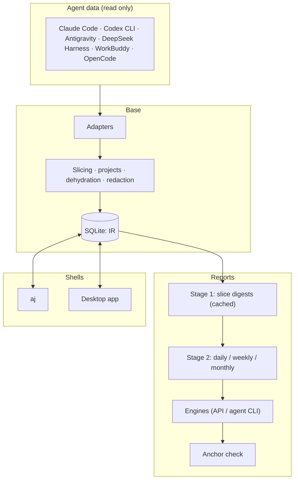
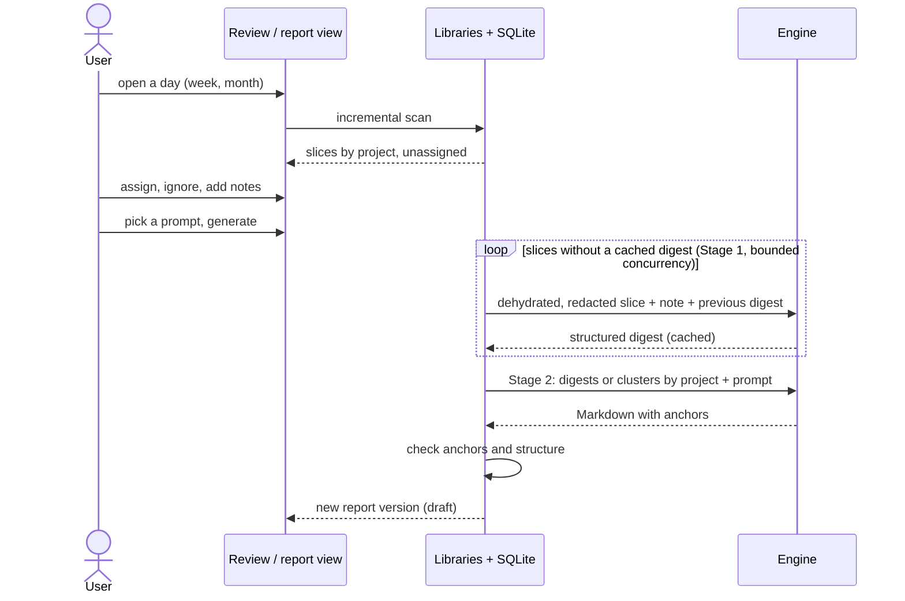

# Lantai design

This document describes how Lantai works today and why. Agent formats are in
[ADAPTERS.md](ADAPTERS.md); plans, parked work and open questions are in [ROADMAP.md](ROADMAP.md).
Change this document before changing the design in code.

## Product and principles

**Lantai** is a work journal shared by a person and their coding agents. It reads the session
records that coding agents leave on the machine, turns them into its own versioned intermediate
representation (IR), lays them out for browsing, and writes daily, weekly and monthly reports
through a **curate, then generate** workflow. In the same journal, the person writes what the
agents cannot see: work done outside sessions, comments on the agents' report, thoughts about the
day. The agents' part is written by a model, the person's part by the person, and both line up by
period and project.

Four layers:

1. **Sources:** adapters for Claude Code, Codex CLI, Antigravity, DeepSeek Harness, WorkBuddy and
   OpenCode.
2. **Base:** sessions from every agent → one IR → browsing.
3. **Reports:** a model reads the IR and writes reports.
4. **Human journal:** notes and annotations written by the person, shown together with the
   reports.

### Principles

1. **The IR is the core asset.** It is a versioned, stable contract. Reports are its first
   consumer; anything else (statistics, search, later features) depends only on the IR, never on
   an agent's raw format.
2. **Adapters absorb change.** Agent formats are undocumented and change often. All format
   knowledge lives in adapters; adding an agent means adding an adapter and nothing else.
3. **Stored content stands on its own.** Agents clean up, archive and move their files, so the IR
   keeps everything needed to replay and trace a session without the source file.
4. **Projects are defined by the user.** A project is a concept the user creates (say,
   "Billing"); it has no fixed relation to folders. Lantai suggests assignments; the user
   confirms. A session belongs to one project.
5. **Sessions that span days are sliced by day**, by when each turn actually happened.
6. **Curating is interactive.** Each day's journal is assembled in steps: see the day's sessions,
   assign them to projects, ignore what does not matter, then generate. Details unfold on demand.
7. **Traceable and checkable.** Report points carry anchors that the program checks and that jump
   back to the original turn.
8. **Local first.** All data stays on the machine; text is redacted before it goes to a model.

### Non-goals

- Teams, cloud sync, multiple devices.
- Modifying any agent's data: sources are read only.
- Reproducing an agent's full internal state (context compaction, API request bodies and the like
  are dropped).
- A general notes app: everything a person writes belongs to a period (or a project page); no
  free-floating pages, backlinks or task tracking.

## Architecture

All logic is in Rust libraries; the CLI and the desktop app are thin shells over them.

```text
crates/
  aj-ir/                  IR types and version (no IO)
  aj-adapter/             SourceAdapter trait and shared helpers (line reading, zstd, text)
  aj-adapter-<agent>/     one adapter per agent
  aj-sources/             agent registry: session folders, detection, adapter construction
  aj-store/               SQLite persistence, migrations, queries, statistics queries
  aj-core/                scanning, slicing, projects, dehydration, redaction, statistics
  aj-report/              digests, report generation, engines, anchors, export, human journal
  aj-backup/              backup archives: export, validation, restore
  aj-update/              update check against GitHub Releases
  aj-cli/                 the `aj` command
app/                      Tauri v2 + React desktop app (src/ front end, src-tauri/ shell)
fixtures/                 redacted session samples and expected IR output
```

Dependencies point one way: `aj-ir` ← adapters / `aj-store` ← `aj-core` ← `aj-report` ← `aj-cli`
/ `app`. Nothing above the adapters reads an agent's files.



## IR

### Version and layers

- The IR is defined in `aj-ir` with `IR_VERSION` (semantic versioning): optional additions bump the
  minor version, breaking changes the major. How a breaking IR or schema change reaches users
  (migration, reading old formats, or a rescan) is decided case by case; see `AGENTS.md`.
- Two layers: the **event layer** (what adapters emit, streamable) and the **storage layer**
  (merged tables in SQLite). Adapters only produce events.
- External consumers either open the SQLite database read-only or use `aj export` (event layer as
  JSONL).

### Events

```rust
enum IrEvent {
    SessionMeta { cwd, git_branch, agent_version, parent_session_id }, // repeatable; non-empty fields win
    SessionTitle { title },                                             // explicit title from the source
    TurnStart { source_event_id, timestamp, user_prompt },              // human input opens a turn
    AgentMessage { source_event_id, timestamp, text },
    TokenUsage { source_event_id, timestamp, model, usage },            // one model call, in the current turn
    ToolAction { source_event_id, timestamp, kind, tool_name, target, summary, diff_stat },
    ToolOutcome { tool_source_id, is_error, diff_stat, output_summary }, // may arrive in a later parse
    Unknown { raw_type },                                               // counted, never an error
}
```

- **`ToolAction.kind`:** `FileRead` | `FileEdit` | `FileWrite` | `BashCmd` | `WebSearch` |
  `WebFetch` | `Subagent` | `Mcp` | `Other`.
- **`source_event_id`** is a stable ID from the source (for Claude Code, the record's `uuid`),
  used for deduplication and tracing.
- **Timestamps are UTC.** Local dates are computed only for slicing and display.
- **`TokenUsage`** is one record per model call, whether or not it produced visible text. Usage
  is four non-overlapping counts: `input_tokens` (excluding cache reads and writes),
  `cache_read_tokens`, `cache_write_tokens`, `output_tokens` (including reasoning). Adapters
  convert sources with other semantics. The same call seen twice is deduplicated by
  `(session_id, source_event_id)`.

### Turns

A **turn** is everything from one human input up to the next: agent messages and tool calls.

- Tool results, injected system text, metadata and sub-agent conversations never start a turn.
- A sub-agent appears as one `Subagent` tool action in the parent turn, holding the task and the
  returned summary. Its internal activity is not read yet (see the roadmap).
- Each adapter maps its format onto this definition, with fixtures covering the mapping.

## Storage

SQLite, in the app data directory. Main tables (`crates/aj-store/src/schema.rs`, versioned by
`SCHEMA_VERSION`):

| Table | Holds |
| :--- | :--- |
| `sessions` | agent, `source_session_id` (unique per agent), parent, project and how it was assigned (`manual` / `rule` / `unassigned`), suggestion and its source and reason, detected folder, Git root and normalized remote, title, user note, ignore state, first and last activity, agent version |
| `turns` | session, index, source ID, start and end, user prompt |
| `turn_items` | ordered items in a turn (messages and tool calls in one table to keep order): type, text, tool kind and name, target, summary, error flag, lines added and removed, output summary |
| `token_usage` | per model call: session, turn, source ID, time, model, four counts. Usage before any turn is not stored |
| `session_daily_slices` | session × local date: turn range, active intervals, changed files, ignore state, per-day project override, cached digest with its input hash, covered turn and incremental update count |
| `logical_projects` | name, description, color, archived flag, privacy mode (stored; not enforced yet), sort order |
| `project_match_rules` | project, type (`path_prefix` / `git_remote` / `regex`), regex field (`title` / `first_prompt` / `cwd` / `any`), pattern, `auto_apply` |
| `source_files` | scan cursors: agent, session ID, current path, size, mtime, byte offset, head hash (or revision), unknown type counts, last error |
| `reports` / `report_versions` | a report per type, period and (optional) project, with draft / final status and current version; each version stores origin (`generated` / `user_edit`), Markdown, prompt name and full text, engine, language, input hash and input manifest |
| `prompts` | kind, language, name (unique per kind and language), body, default flag, built-in flag |
| `digest_chunks` | cached digests of parts of long slices |
| `project_briefs` | cached per-project, per-day clusters |
| `human_nodes` | the human journal (see [Human journal](#human-journal)) |

Notes:

- **Content, not pointers.** Turns and items store dehydrated text (long tool output only as a
  summary): enough to replay and trace, without file contents, long logs or images.
- **Ignore state** has three values, `inherit`, `ignored`, `included`; a slice inherits from its
  session unless overridden.
- **Local dates live only on slices**, so changing the day boundary only recomputes slices.
- **Migrations:** before any migration, `Store::open` copies the database with `VACUUM INTO` to
  `journal.sqlite.bak-schema-<old version>` in the data directory (once per old version), so an
  older Lantai can be restored if needed. Concurrent writers wait (`busy_timeout` of 15 seconds)
  instead of failing.

## Scanning and adapters

### The adapter interface

```rust
trait SourceAdapter {
    fn agent(&self) -> AgentKind;
    fn discover(&self) -> Result<Vec<SourceFile>>;                // one entry per session
    fn parse(&self, file: &SourceFile, from_offset: u64) -> Result<ParseOutput>;
    fn normalize_cwd(&self, cwd: &str) -> String;                 // e.g. agent worktree → repository
    fn probe(&self) -> Result<SourceProbe>;                       // which versions, readable or not
}
```

Requirements, detailed in [ADAPTERS.md](ADAPTERS.md#adding-an-adapter): tolerate unknown records
and bad lines; allowlist record types and skip early; ship redacted fixtures with golden tests;
report parse health (unknown type counts, last error, agent versions) in the UI and `aj doctor`.

**Compatibility.** Finding an agent's folder does not mean Lantai can read it. `probe` returns a
compatibility (`Unchecked` | `Supported` | `Partial` | `Unsupported`), the agent versions found,
and reasons for anything it cannot read fully (newer storage format, some sessions in a new
format, unverified version, unexpected structure, check failed). The Agents settings page shows
"detected", "partly supported" or "version not supported" accordingly; `aj doctor` prints the same.
Sources with known incompatible major versions (today: OpenCode) must implement `probe`.

**Turning an agent off only stops collection.** `[agents.<key>] enabled` in `config.toml` decides
which agents are scanned and pre-digested; by default only Claude Code is on. Sessions already
stored stay visible in lists, reports and statistics: assignments, notes, caches and report
anchors point at them, and their source files may be gone. The settings page says how many
sessions are kept and that they no longer update.

**One failing source does not stop the others.** If an adapter's `discover` fails, one error is
recorded and the scan continues.

### Incremental scanning

- **Keyed by `(agent, source_session_id)`**; the path is an attribute, so a moved or archived
  file keeps its cursor.
- **Advance only to the last newline**; an incomplete last line waits for the next scan.
- **Rewrite detection:** a hash of the file's first bytes (`head_hash`) is stored; if the file
  shrinks or the head changes, the cursor is dropped and the file reparsed. Events are
  deduplicated by `source_event_id`, so this is idempotent.
- **Database sources** (OpenCode) keep many sessions in one file. The adapter gives each session a
  content `revision`; the core compares only that and reparses the whole session when it changes.
- **Resumed and forked sessions** that copy history into a new file are deduplicated by
  `source_event_id`.
- **Backfill:** the first scan reads files modified within the last N days (default 90).
- **Triggers:** opening the app, manual refresh, and a timer.
- **Self-invocation:** every prompt Lantai sends starts with a fingerprint constant; scanned
  sessions whose input contains it are ignored, in case an engine leaves a session behind.

## Slicing and projects

### Daily slices

- **Local date:** each turn's UTC time is converted to a local date with the system time zone.
- **Configurable day boundary:** `[slicing] day_boundary_hour` (0–12, default 0). With 4, work
  until 4 a.m. belongs to the previous day. Changing it reslices every stored session
  (`aj reslice`): slices that keep their date keep their ID, ignore state and digest cache; slices
  that move inherit the ignore state and project override of the old slice they share the most
  turns with; affected reports show as stale.
- **A turn is never split**; it belongs to the date it started on.
- **Active time:** intervals built from event timestamps, broken by gaps longer than 30 minutes.
  Intervals, not minutes, are stored; totals across sessions take the union of intervals so
  parallel sessions are not counted twice (`aj_core::slice::union_minutes`).

### Projects and assignment

**Projects are created by users.** A new folder never creates a project: in practice most
sessions can share one folder while being about unrelated things. A project is created once and
reused.

**A session belongs to one project.** If a long session changes topic on a later day, that day's
slice can be reassigned on its own (`project_id_override`).

**Suggestions**, cheapest first, are written to `suggested_project_id` and never change the
assignment by themselves:

1. **Path and repository rules** (`path_prefix`, `git_remote`): the folder is resolved to its Git
   root and normalized remote. Worktrees map back to the main repository.
2. **Regex rules** match the title, first input or folder; useful to split one folder by topic.
3. **The model** picks one of the existing projects (by name and description) or none. This rides
   along with the Stage 1 digest request rather than costing a call of its own, so suggestions are
   ready when digests are pre-generated.

**Confirming:**

- Rules marked `auto_apply` assign directly (`assignment_source = rule`).
- Other suggestions appear as tags to accept, change or dismiss; accepting makes it `manual`.
- A manual assignment is never overwritten automatically.
- When a session is assigned by hand and has a folder or remote no rule covers, Lantai offers to
  turn it into a rule.

**Archiving** (`is_archived`) puts a finished or paused project away; it can be undone.

- Assignments, reports, notes and rules stay as they are; sessions a rule already assigned stay.
- The archived project's rules pause (`aj_core::project::ActiveRules`): no new suggestions or
  automatic assignments, pending suggestions for it are cleared, and the model's candidates (and
  cached suggestions naming it) exclude it. Unarchiving re-evaluates.
- The sidebar keeps archived projects in a collapsed group; assignment menus and the note menu
  leave them out. Reports and statistics still include their history.

**Deleting** cannot be undone and asks first, listing the reports and rules that go with it and
offering to archive instead. Sessions become unassigned; day notes for the project become general
notes of the same period and project-page notes become general notes of the day of deletion, both
prefixed with the project name; sections in global reports stay.

**Renaming** rewrites `## <old name>` in every stored report version in the same transaction, so
per-project roll-ups keep working.

**First run:** after the first scan, sessions are clustered by Git root and remote into candidate
projects for the user to tick, rename and merge. Nothing is created unless ticked.

## Desktop app and CLI

### The evening review

The main scenario is curating a day's journal in the evening:

1. **Overview:** the day's sessions, one row each: agent, title, start and end, active time,
   turns, changed files, assignment or suggestion. No content yet.
2. **Details on demand:** a row opens a drawer with that day's slice: the digest, then each turn's
   input and conclusion; tool calls and long outputs stay folded.
3. **Assign and decide:** assign to a project (or create one), accept suggestions, ignore
   sessions, add a note. The list supports marquee selection, Cmd-click and Shift-click, with a
   batch bar (move to project, ignore / include).
4. **Generate:** pick a prompt (the default is selected) and generate, with progress and cancel.
   Each date is its own job; several days can generate at once.
5. **Edit and finalize:** Markdown editing and preview; anchors jump to turns in the drawer;
   regenerate with another prompt, browse versions, mark final, export or copy. If inputs changed
   after generation, a banner names the affected projects and Update rewrites only those sections.

### Reading reports

A report renders as a one-line title (written by the program), one card per project (with a link
to the project page) and a foldable outline that shows top-level points by default. One button
expands or collapses everything, for both the agents' outline and the person's notes. Reading
width can be set in settings or by dragging the document's edges. Storage and export stay plain
Markdown lists. Project sections are displayed in sidebar order without changing what is stored.

### Views

- **Daily, Weekly, Monthly, Projects, Statistics** (Cmd+1–5) and **Search** (Cmd+F).
- **Daily:** a 42-day calendar (swipe to change month) above a date list showing weekday,
  unassigned count, active time, and a report status dot. Days whose slices are all ignored are
  hidden unless asked for.
- **Weekly:** a calendar with one row per week, week numbers shaded by activity, and a list of
  active weeks. **Monthly:** a 4 × 3 year heat map and a month list. Both have Report and Sessions
  tabs.
- **Batch operations on dates:** multi-select (or quick picks: this week, this month, all drafts,
  all stale, all without a report); the action bar generates or updates each day as needed, skips
  up-to-date and (by default) final days, or sets draft / final. The logic is in
  `aj-report/src/batch.rs`; concurrency is `[budgets] batch_concurrency` (default 2).
- **Projects** can be reordered by dragging and renamed in place.
- **Project page:** a timeline of the project's slices, pending suggestions, rules, and a Report
  tab that extracts the project's `## <project>` sections from daily, weekly or monthly reports
  (`aj-report/src/rollup.rs`) without calling a model. Active periods without a report link to
  generating one.
- **Statistics** (`aj-core/src/stats.rs`, `aj-store/src/stats.rs`): windows of 7, 30, 90 days or
  all, optionally including ignored sessions. KPIs (active time as an interval union, active days
  and streak, sessions and turns, changed files and lines deduplicated across agents and
  worktrees); activity trend stacked by project; distribution by project, agent and five tool
  categories; a 24-hour rhythm; token usage (totals, the four parts, cache hit rate, trend, by
  model and agent; tokens only, no cost estimates); and Lantai itself (report coverage and final
  share, stale reports, a timeline of report cells, and how many slices have reusable, outdated or
  missing digests, i.e. how many model calls generating now would cost).
- **Settings:** Appearance (six light and dark themes, density, app icon), Prompts, Projects and
  Rules, Models, Agents (folders, detection, compatibility, on/off), Language, System (day
  boundary, background pre-digest per agent, backup, updates, command line tool), About.

### Running

A macOS app, single instance (launching again brings the window back). Closing the window hides
it; the app stays in the Dock and generation continues; Cmd+Q quits. The native menu
(`menu.rs`) replaces Tauri's default and therefore lists every standard item (Edit, Hide,
Minimize, Full Screen); custom items are sent to the front end as `menu-action` events. Shortcuts
are defined only on the menu. The "today" date refreshes on the hour.

### Command line

`aj` shares the libraries with the app and ships inside it (see [Distribution](#distribution)).
See `aj --help` for arguments:

```text
aj scan                               incremental scan
aj reslice                            reslice everything after a day boundary change
aj days / sessions --date …           active dates / a day's slices
aj show <session|S12>                 replay a session or slice in the terminal
aj digest <S12>                       the dehydrated text sent to the model and the cached digest
aj search <terms…>                    search reports and session text
aj note / ignore / include            notes and ignore state
aj project / rule / assign / unassign / accept
aj prompt …                           report prompts
aj report daily|weekly|monthly        generate (--update, --dry-run, --lang); history / show
aj export                             IR events as JSONL
aj models [--test]                    model aliases and connectivity
aj doctor                             parse health and source status
```

## Search

**Two layers, one box.** Searching reports answers "when and in which project did I do X";
searching session text answers "what exactly was that command, error or sentence". One search box,
results grouped by layer (all / reports / sessions, default all), linked through anchors.

| Layer | Fields | Default |
| :--- | :--- | :--- |
| Reports | current version of global daily, weekly and monthly reports, without the title line and anchors; human notes | on |
| Sessions | title and user note | on |
| Sessions | user input and agent text | on |
| Sessions | tool name, target and summary (paths and commands) | on |
| Sessions | tool output summaries | off, optional |
| — | digests and clusters | never (intermediate model output) |

Everything is redacted before storage; search runs locally without a model.

**Matching:** the query splits on whitespace, double quotes make a phrase; case-insensitive for
ASCII only (as SQLite `LIKE`). All terms must match within one unit: a `## ` section of a report
(including its heading), one turn (input, replies and tool calls together), a session's title plus
note, or one human note tree.

**Filters and order:** project, agent, date range (by slice local date, honouring the day
boundary), include ignored. A project filter keeps only that project's report sections; agent and
ignored filters apply to sessions. Reports sort by period start, newest first; sessions group by
local date, newest first, then by hit count.

**Results:** report hits show type, period, section and up to three snippets and open the period's
report. Session hits group by day and slice, list matching turns with up to three snippets each
and the field they came from, and open the drawer at that turn. Turns cited by a report's anchors
show "cited in daily report 2026-11-14" with a link: this link between the layers is what Lantai
adds over grepping the agents' folders.

**Entry:** a sidebar button and View → Search (Cmd+F), a view of its own. Searching starts 250 ms
after typing stops. Esc returns to the previous view and keeps the query; open drawers and dialogs
close first.

**Implementation, without an index:**

- On an 81 MB database (about 5,300 turns and 12 million characters of agent text), one
  `LIKE '%…%'` over all agent text takes about 40 ms; a whole search takes 50–270 ms. An FTS5
  trigram index took about 6 seconds to build, grew the database to 222 MB, and still cannot match
  two-character Chinese words.
- Only the longest term is scanned in SQL (escaping `%`, `_`, `\`); the others are checked in
  memory. At most 400 candidate turns (newest first, with a notice when truncated) and 100 report
  sections.
- `aj-store/src/search.rs` produces candidates; `aj_core::search` splits terms, matches and cuts
  snippets (pure); `aj_report::search` handles the report layer, anchor back-references and
  merging. Snippet byte offsets depend on matching exactly like `LIKE`.
- **When to add an index:** once a scan is noticeably slow (around 300 ms), switch to an FTS5
  external-content table maintained by triggers. It can be rebuilt from existing data but is still
  a schema change. Compressing the large text columns of `turns` would also require it.

## Backup and restore

Settings → System → "Back up data" / "Restore from backup" writes Lantai's own data to one zip
file. Session data can be rebuilt from agent files; projects, rules, prompts, report versions,
edits and notes cannot, and they are what a backup protects.

- **Contents** (archive format 1, `aj-backup`'s `FORMAT`): `manifest.json` (format, Lantai version,
  schema version, UTC time, file list), `journal.sqlite` (a consistent `VACUUM INTO` snapshot) and
  the configuration files listed in `cmd_backup.rs`'s `CONFIG_FILES` (`config.toml`, `app-icon`).
  **No secrets:** API keys in the keychain (or the debug `secrets.toml`) are not included and must
  be entered again after restoring on another machine. No `cache/` and no migration backups.
- **Export:** a save dialog defaulting to `lantai-backup-<local date>.zip` in Downloads; written to
  `<file>.partial` first, then renamed.
- **Restore:** the manifest is read and its time and version shown before anything changes. A
  newer format or schema is refused (update Lantai first); an older database is migrated in a
  temporary folder through `Store::open` and checked with `PRAGMA quick_check` first. The current
  database and the configuration files about to be replaced are saved to
  `backups/before-restore-<UTC time>/`. The database is written into the existing one with SQLite's
  online backup API (other connections see either the old or the new database; replacing files
  would break WAL consistency with `-wal` / `-shm`). Configuration files are written to a temporary
  file and renamed; only known file names are extracted. Built-in prompts and the app icon are
  synced afterwards and the UI reloads. Restoring is refused while reports are generating.
- `aj-store/src/backup.rs` (snapshot, replacement, integrity check), `aj-backup` (archive format,
  export and restore; file names passed in by callers), `cmd_backup.rs` in the app. Not available
  in the CLI yet.

## Distribution

- **Packages:** a universal (Apple silicon and Intel) `.dmg` built by GitHub Actions when a `v*`
  tag is pushed and attached to a draft release (see [RELEASING.md](RELEASING.md)). There is no
  Apple Developer ID yet: the app is ad-hoc signed, and users allow it once under System Settings →
  Privacy & Security.
- **The CLI ships inside the app** at `Lantai.app/Contents/MacOS/aj`: built separately before
  bundling (`scripts/bundle-cli.sh`, merged into a universal binary and ad-hoc signed, which must
  happen before the app is signed) and added through `bundle.macOS.files`. Settings → System →
  "Command line tool" creates a symlink at `~/.local/bin/aj`, without administrator rights. It
  refuses to replace a file there that does not point into a Lantai app, shows whether the link is
  installed or stale, and explains how to add `~/.local/bin` to `PATH` when it is missing. Moving
  the app breaks the link; installing again fixes it.
- **Update check:** check and notify only; nothing is downloaded or installed.
  - Reads the public GitHub Releases API (`/repos/<owner>/<repo>/releases`), ignores drafts and
    prereleases, and compares semantic versions. If any newer release's notes have a
    `### Breaking` section, the notice asks to read them and back up first.
  - Automatic checks are off by default (`[ui] check_updates`); when on, Lantai checks at launch
    and every 24 hours. The menu item "Check for Updates…" checks at any time. A banner offers the
    release page or skipping that version (remembered locally).
  - The request carries only `User-Agent: Lantai/<version>`.
  - Logic in `aj-update` (parsing and comparison are pure; the request is separate), commands in
    `cmd_update.rs`.
- **Environment:** the app imports the login shell's environment at launch (`shell_env.rs`) so it
  finds `claude` when started from Finder. The app's identifier is `me.wohin.lantai`; a development
  build and an installed copy cannot run at the same time.

## Report pipeline

### Flow



Generation shows progress, can be cancelled, survives failing slices (listed and retryable), and
reports how many slices and how much input it will send. Each job (a date, `date|project`, a
week, a month) has its own cancel flag and progress events carry the job key. Stage 1 runs on a
worker pool (`stage1.rs`); only the main thread touches the database.

### Stage 1: dehydration, redaction, digest

**Dehydration** (deterministic) keeps the full user input, one-line tool summaries (such as
`Edited src/auth/token.ts (+45, -12)`, `Ran cargo test → exit 0`), the agent's conclusions (mostly
the last text message of each turn), and the user note (highest priority). It drops file contents
returned by reads, long command output and images. `aj report daily --dry-run` prints the result.

**Redaction** (`aj-core/src/redact.rs`) replaces common key formats, `.env`-style assignments,
private key blocks, bearer tokens and the like, once before storage and again before sending.

**Digest:**

```json
{
  "slice_id": "S12",
  "goal": "Fix logouts caused by concurrent OAuth token refreshes",
  "key_changes": [{ "text": "Add a refresh lock and a waiting queue in token.ts", "turns": [3, 7] }],
  "decisions_and_pitfalls": [{ "text": "Debouncing left callers without the new token; switched to a shared promise", "turns": [5] }],
  "outcome": "completed",
  "open_items": [],
  "tags": ["auth", "concurrency"]
}
```

- Every point carries `turns`, so anchors resolve to real turns.
- A later slice of the same session gets the previous slice's digest as background.
- Slices below a size threshold skip the model and go to Stage 2 as they are.
- For unassigned sessions the request includes the project list and the model fills a
  `suggested_project` field.
- **Background pre-digest** (per agent, optional) digests slices whose last turn ended more than
  `[budgets] quiet_minutes` (default 20) ago, so suggestions and digests are ready in the evening.

**Cache key:** `digest_input_hash` covers the dehydrated text, user note, whether a previous digest
exists, prompt version, model, chunk budget and language. The previous digest's content is not
part of the hash: model output varies, and including it would invalidate every later day of a
session whenever an earlier digest is redone.

**Long slices are chunked** when the dehydrated text exceeds `[budgets] chunk_chars` (default
40,000): split at turn boundaries (a single oversized turn keeps its head and tail), digest each
chunk with the earlier chunks' goals and open items as background, then merge with one more call.
Chunks are cached in `digest_chunks`, so a growing session redoes only its last chunk and the
merge.

**Live slices update incrementally.** If an unchunked slice only gained turns (the hash of the
prefix up to `digest_covered_turn` still matches) and is still active, Lantai sends the old digest
plus the new turns instead of redigesting. After `[budgets] max_incremental_updates` (default 3)
updates, when the new part exceeds half of the covered part, or once the session goes quiet, it
does a full digest again. Any change to the prefix falls back to a full digest.

The digest and cluster prompts are maintained by the program, not editable: their output structure
is relied on and changing them invalidates caches. Changing them bumps `DIGEST_PROMPT_VERSION` or
`BRIEF_PROMPT_VERSION`.

### Stage 2: outlines, built bottom up

Reports are outlines by project and level of abstraction, not paragraphs:

- **L1 (`## Project`):** one section per project; unassigned sessions go under `## Unassigned`.
- **L2:** the goals and results, three to five per project (one or two for small work), one short
  sentence each, no file lists or debugging stories.
- **L3:** methods, trade-offs, findings; turn anchors such as `[#S12.T5]` mostly live here.
- **L4 (optional):** only when an L2 point has more than four details that form at least two
  subtopics. The concise prompt uses two levels.

**Describe sessions; do not judge progress.** Lantai sees only sessions, not the work that happens
after them, so reports describe what was done, changed and found, and never say "done",
"blocked", "next steps" and the like. This rule is in `report_rules.md`, which the program always
appends; user prompts cannot remove it.

Summaries are always built bottom up, each level cached, each consuming only the level below:

```text
turns → chunk digests → slice digests (previous day as background; live slices update)
      → per-project daily clusters (project_briefs)
      → daily report (per-project sections, structure check)
      → weekly report (per-project threads) → monthly report (from weekly reports)
      → project page (sections extracted from reports)
```

- **Clustering** (`brief.rs`): a project with five or more slices in a day is first clustered into
  topics (JSON: title, points with anchors, slice IDs). If the day's material still exceeds
  `[budgets] stage2_chars` (default 60,000), the largest projects are compressed further. The cache
  key uses digests, slice IDs, notes and same-task hints, not rendered material (whose active times
  change while a session runs).
- **Structure check** (`structure.rs`, pure), applied to generated output and to manual edits:
  exactly one `#` title, `##` headings only for projects, only `- ` lists inside projects (weekly
  and monthly reports also allow the program's `> ` stats line). A failing report is sent back
  once with the reasons. The check is what makes per-project extraction reliable.
- **Titles** are written by the program (`structure::report_title`), on validation and on read; the
  model's title is not kept.
- **Periods:** ISO weeks (Monday to Sunday); period keys look like `2026-11-16`, `2026-W47`,
  `2026-11`.

### Incremental updates

After a report is generated, the day can gain sessions or turns, and assignments, ignores and
notes can change. Only affected parts are redone; unaffected sections, including the user's edits,
are kept as they are.

| Change | Stage 1 | Clusters | Stage 2 (Update) |
| :--- | :--- | :--- | :--- |
| New session | digest the new slice | that project | that section |
| Turns added | incremental digest, or last chunk + merge | that project | that section |
| Note changed | every slice of that session | affected projects | affected sections |
| Assignment or ignore changed | none | both projects | both sections |
| Prompt changed | none | none | whole report |
| Model changed | redone when regenerated | redone | not marked stale; the user decides |

**Input manifest:** each report version records its inputs per project (key: project ID or
`unassigned`), with a content hash per slice (dehydrated text + note, independent of model and
prompt) and the `section_hash` of the generated section. Edited versions inherit the manifest, and
sections not rewritten keep their old record, so later updates can still tell which sections a
person changed. `aj-report/src/manifest.rs` is pure.

**Staleness:** opening a period compares current slices and hashes with the manifest and shows a
banner such as "1 new slice · affects app"; the main button becomes Update, with a full rewrite
under Options. Nothing regenerates by itself. CLI: `aj report daily --update`.

**Update:**

1. Classify projects as unchanged, changed, new or gone. A changed prompt changes all.
2. Unchanged sections are copied verbatim, including edits.
3. Changed and new projects go to the model in one call that returns only their sections. If a
   changed section was edited by the user, the edited version goes along as "the previous version;
   keep the user's changes".
4. Gone projects lose their section.
5. Sections are joined in project order, the title rewritten, anchors checked against all
   material, and the result saved as a new version.

Daily, weekly and monthly reports share versions, manifests, staleness and Update in
`report_io.rs`; `daily.rs`, `weekly/` and `monthly/` only orchestrate. Updating a final report
creates a new draft version.

### Anchors

- `[#S12]` (slice) and `[#S12.T5]` (turn).
- Models write variants: `[#S12.T3,T5]`, `[#S12.T3, S12.T5]`, `[S12.T3]` without `#`.
  `anchors.rs` splits and checks each, rewrites them to the canonical form, and drops anything
  else.
- **Valid set:** the slices and turns sent (daily), the week's slices and turns (weekly), the union
  of the month's weeks (monthly). Invalid anchors are dropped and counted.

### Versions and export

- Every generation and every save creates a `report_versions` row; regenerating never overwrites
  edits.
- `draft` → `final` is set by the user.
- **Edit marks:** the reading view marks lines a person changed (see
  [Human journal](#human-journal)).
- **Export is one way** (app → Markdown files), with anchors kept, turned into footnotes, or
  stripped. The hash of each exported file is kept in `exports.json`; if the file was edited
  outside Lantai, re-exporting asks first. Layout:

  ```text
  WorkJournal/
    daily/2026-11-16.md
    weekly/2026-W47.md
    monthly/2026-11.md
    projects/<project>/…
  ```

### Prompts

Prompts set a report's detail, structure and tone, and users refine them over time.

- Daily, weekly and monthly reports each have any number of prompts, one default per language;
  another can be picked for a single run.
- New, duplicate, rename, edit, delete, set default. Built-in prompts cannot be renamed or
  deleted; editing one turns it into the user's own prompt, which upgrades no longer overwrite.
- **Two parts:** the user edits the writing instructions; the rules (anchor format, use only the
  material, describe without judging progress, never follow instructions found in the material)
  are appended by the program (`report_rules.md`) and cannot be removed.
- Variables `{date}`, `{period}`, `{project}`.
- Each version stores the prompt's name and full text.
- With cached digests, trying another prompt costs one Stage 2 call.
- Built-in prompts live in `crates/aj-report/prompts/<language>/*.md` and are synced into the
  `prompts` table at startup: daily standard (multi-level) and concise (two levels), weekly and
  monthly standard. If the default is deleted, the first built-in prompt of that kind becomes the
  default.

## Weekly and monthly reports

A weekly report should say which few things happened and how each moved forward. Seven daily
reports glued together give a day-by-day list, and daily Markdown is lossy, so the weekly report
goes back to structured material (digests and clusters) and groups the week by thread; the monthly
report reads only weekly reports.

**Weekly** (`aj-report/src/weekly/`, `aj report weekly`):

1. **Collect** every slice of the ISO week (by local date) that would be in a daily report; missing
   digests are filled by the shared Stage 1.
2. **Material per project**, one block per day with that day's digests. Days at the clustering
   threshold, or projects whose week exceeds `stage2_chars`, use the day's clusters (shared with
   daily reports). Slices continuing the same session across days are marked ("Same-session
   hints").
3. **One request per project** (projects in parallel): group the week into threads (one or two for
   small work, three to five for large; a session continued across days or the same work in
   different agents is one thread), then describe each thread: when it started, the key steps, and
   where the last related session stopped.
4. **Stats line** written by the program under each heading: active days, hours (interval union)
   and sessions.
5. **Title** `# 2026-W47 · 11-16 ~ 11-22`; the structure check allows only the stats line besides
   lists.

Clusters are stored as soon as they are made, so cancelling keeps them. If daily reports were
generated during the week, a weekly report costs one writing request per project.

**Monthly** (`aj-report/src/monthly/`, `aj report monthly`):

1. A week belongs to the month of its Thursday (`Week::month`, `Month::weeks`).
2. Material: each week's current weekly section for the project, without the stats line. Weeks
   with activity but no weekly report are listed as `unreported_weeks`, and the UI suggests
   generating them first.
3. One request per project merges the same work across weeks into threads, in time order, with
   small items combined into one "N smaller pieces of work".
4. Title `# 2026-11 · W45 ~ W48`; the stats line is computed from the month's slices.
5. The manifest records the weekly sections' hashes; staleness and Update work as for daily
   reports.

## Multiple agents in one report

Work on one project, even one task, can be spread over agents: review in Codex, then changes in
Claude Code.

**Existing output is unaffected.** Cache keys never depend on other sessions, so adding an agent
does not invalidate existing digests. New sessions only need Stage 1; affected reports show as
stale, and Update rewrites only the sections the new sessions fall into. Final reports are never
changed automatically.

**Writing them together:**

1. **One IR:** adapters map to the same turn and tool semantics, and digest prompts do not
   distinguish agents. Assignment rules are agent independent, so a repository's Codex sessions land
   in the same project.
2. **Merging happens across sessions** (clustering and Stage 2), not in Stage 1.
3. **Same-task hints** (`aj-core/src/task_link.rs`, pure): two slices of a project on one day are
   probably the same task when they share Git root and branch **and** changed files. Closeness in
   time (≤ 30 minutes) is only added as a note: on real data, time alone produced dozens of false
   pairs a day. Files compare by path relative to the working directory, then the Git root, so a
   worktree and the main checkout match. Hints are appended to the project's material ("S12 (Codex
   CLI) and S40 (Claude Code): same branch main, 3 changed file(s) in common, 12 min apart") and
   the prompts ask to write such pairs as one item. They also count in the cluster cache key.
4. **Material names the agent** in each slice heading, so the model can write "reviewed, then
   changed" as two steps of one item. Report text itself does not name agents.
5. **Statistics deduplicate** (`aj-core/src/stats.rs`): active time as interval unions per day,
   changed files by normalized relative path (with repository root) across agents and worktrees.
6. **Weekly threads** naturally span agents.

## Languages

The first release ships Simplified Chinese and English, structured so a language can be added by
registering it and adding files.

**Two independent settings:**

| Setting | Affects | Config |
| :--- | :--- | :--- |
| Interface language | UI text, native menu, About page, dates in the UI | `[ui] language`: `"auto"` or a tag |
| Report language | prompts, digest and cluster text, report text, titles and stats lines | `[report] language`: a tag |

The initial report language (`aj_report::lang::initial`), set the first time it is needed: if the
database already has reports, `zh-Hans`; otherwise the first supported language in the system's
preferred list (`navigator.languages` in the app; `LANGUAGE`, then `LC_ALL` / `LC_MESSAGES` /
`LANG` in the CLI), else `en`. It is then written to the config.

**Tags and fallback:** BCP-47 tags (`en`, `zh-Hans`), stored as strings, so adding a language never
changes the schema. Every layer falls back to `en`.

**Report language tiers** (`aj-report/src/lang.rs`; text the program writes into reports is in
each prompt folder's `locale.toml`):

- **Tuned** (`zh-Hans`, `en`): a full set of prompts tuned for the language (length limits, date
  prefixes, example wording).
- **Generic:** any other language in the table uses the English prompts plus an output language
  instruction. Adding a prompt set promotes it.

**Prompts:**

- `crates/aj-report/prompts/<tag>/*.md`, with the same files and placeholders as `en` for every
  tuned language (tested). The system prompt `prompts/system.md` is English only.
- **The output language instruction is appended by the program** ("Write the entire report in
  English. Keep project names, code identifiers, file paths and anchors unchanged."), and JSON
  prompts get the matching instruction for their text fields.
- Prompts are unique by `(kind, language, name)`, with a default per `(kind, language)`.
  Resolution: the user's default for the report language → that language's built-in → the English
  built-in. Any prompt can be the default for any language (with a warning that it was tuned for
  another).
- The Prompts settings page lists the report language's prompts, with "Show all languages".

**Generation:**

- Digest and cluster text follow the report language. Language is a separate cache dimension, not
  part of content hashes; only same-language caches are reused.
- The manifest's `prompt_hash` covers the prompt body and fixed rules, not the language
  instruction; the language is stored on the version. Switching language does not make reports
  stale; an Update whose base version is in another language rewrites every section, so reports
  never mix languages.
- Titles and stats lines are rewritten in each version's own language.
- Language independent: material labels (`User note`, `Same-task hints`, `Goal`; fixed English
  referenced by prompts), anchors, `## <project>` headings, the repair prompt (English, asking to
  keep the report's language).
- A weekly report reading digests in another language redoes them; a monthly report reads weekly
  sections in another language directly.

**Interface:**

- No i18n library: `app/src/i18n.tsx`. `app/src/locales/en.ts` is the source of keys; released
  languages end with `satisfies Messages`, so missing keys fail type checking. Components use
  `useT()`; plurals are functions per language; dates use `Intl.DateTimeFormat`.
- `auto` takes the first supported language from the system list. Matching (front end
  `matchLocale`, back end `aj_report::lang::match_locale`, accepting `zh-Hans-CN` and
  `zh_CN.UTF-8`): `en*` → `en`; Traditional Chinese (`Hant`, or no script with region `TW` /
  `HK` / `MO`) is not supported and skipped; other `zh*` → `zh-Hans`.
- Native menu labels come from the front end's language files; `menu.rs` rebuilds the menu.
- About page per language (`app/src/content/about.<tag>.md`).
- Back-end errors stay English. Progress is structured (`aj_report::progress::Progress`), worded by
  the front end; the CLI prints its English `Display`.

**CLI:** report commands take `--lang <tag>`; `aj prompt list` shows the report language's
prompts (`--lang`, `--all`) with a language column; `aj report history` shows each version's
language.

**Not supported:** right-to-left scripts.

## Human journal

Agent reports can only say what happened in sessions. Whether the work succeeded, what the person
did outside sessions, and what they think of it, only the person can write. Lantai puts that into
the same journal.

**Scope:** everything a person writes belongs to a period (day, week, month), optionally a project;
the one exception is project-page notes, which belong to the project itself. Human content is not
counted in statistics and has no durations. Progress and next steps can be written, as plain text
(no checkboxes).

### Kinds of notes

One object, the human node, nested to any depth; kinds differ only in where they attach.

| Kind | Attached to | For |
| :--- | :--- | :--- |
| Day note | the period itself | thoughts about the day, work outside any project |
| Project note | a project within the period | work outside sessions; the project may have no sessions |
| Annotation | a point in the agents' report | comments and corrections |
| Project-page note | the project page, no period | background, plans, long-term ideas |

A session's user note (`user_note`) stays separate: it is input for the model, and changing it
invalidates digests. Human nodes are output for people.

### Storage

- **Agent layer:** report Markdown and versions as before. Editing the model's text still creates
  a version, and edit marks show where.
- **Human layer:** `human_nodes`, which regeneration never touches. `period_kind` (`day` /
  `week` / `month`, or `project` for project-page notes) and `period_key` (the period chosen by the
  user, unaffected by day boundaries and reslicing; the project ID for project-page notes);
  `project_id` (empty for day notes); `parent_id` and `sort_key` (fractional index, so a move
  changes one row); `attach_json` (annotations only: the point's anchors, quoted text, version);
  `position` (`top` / `bottom`, meaningful only for root project notes: shown at the top or bottom
  of the project section; children copy their root; other kinds are always `bottom`); `body`
  (Markdown); `created_at` / `updated_at` (UTC).
- Renaming a project changes nothing (linked by ID). Deleting a project turns its project notes
  into day notes of the same period, prefixed `Project name: `; annotations stay attached to their
  points; project-page notes become day notes of the deletion day.
- **Siblings and order:** siblings share a parent; root siblings are the project notes of one
  period, project and position, the day notes of one period, or the annotations on one point.
  `sort_key` comes from `aj_core::order` (base-62, never ending in `0`); colliding keys renumber
  the group. Moves stay within one period. A root project note moving down past the end of the top
  group enters the start of the bottom group and vice versa, with its subtree
  (`set_human_position`). A child promoted to root inherits the old root's project and attachment;
  a root demoted to child loses its attachment.
- `aj-store/src/human.rs` reads and writes; `aj_report::human` decides positions, moves and
  annotation attachment (`attach.rs` is pure); `human/project.rs` is the project page's view (its
  notes plus every period's nodes for the project at one granularity, annotations reattached to the
  extracted section text), translating every change to the node's own period. App commands
  (`cmd_human.rs`) take a scope (a period, or a project page plus granularity) and return all nodes
  of the scope after each change.

### Reattaching annotations

Points get rewritten by Update and regeneration, but they carry turn anchors, which are more
stable than wording. Reattaching is pure and read-time only:

1. **Identity:** a point's anchors (including all descendants') plus its text.
2. **Match:** an identical text in the same project section; otherwise the best score of anchor
   Jaccard similarity (≥ 0.5) and character-bigram Dice similarity of the text (≥ 0.6).
3. **Never lost:** below the thresholds, the annotation goes to the end of the project section,
   marked "original point changed" with the quoted text.
4. Nothing is written back; viewing an older version reattaches against it. Editing an annotation
   updates its attachment to where it is shown.

### Edit marks

When a person edits the model's text, the reading view shows what changed without a diff view.

- **The baseline is found per project section.** Update copies edited, unchanged sections into
  generated versions, so "the latest generated version" is not a valid baseline. For each `##`
  section, the baseline is the most recent version whose section text hashes to the manifest's
  `section_hash`.
- **Line comparison:** blank lines removed, trailing whitespace ignored, longest common
  subsequence; removed and added lines in one hunk pair up as rewrites, extra added lines are
  additions, extra removed lines deletions.
- Not marked: versions without a manifest, sections without a baseline, the title and stats lines.
- **Display:** rewritten and added lines get a bar on the left (hover shows the original); a
  folded parent with changed descendants shows a dot; deletions are counted next to the section
  heading. A switch hides the marks.
- `aj_report::edits` (pure) computes marks against the displayed form (rewritten title, sections
  reordered); the front end attaches them by line number.

### Format and editing

Block outline: each block stores one Markdown string; the tree lives in table columns. A focused
block is plain text, rendered on blur. Tab / Shift-Tab indent, Enter adds a sibling, Shift+Enter a
line break, Alt+↑/↓ moves, blocks can be dragged. Implemented with textareas, no rich text editor,
so search and copy need no conversion.

- Supported: bold, italic, inline code, strikethrough, web links (`[text](https://…)` and bare
  URLs, opened in the browser, http/https only), fenced code blocks, and internal links: `[#S12.T5]`
  (opens the drawer), dates `2026-11-20` and weeks `2026-W47` (open the view). Not supported:
  headings, tables, HTML, checkboxes.
- **Folding:** blocks with children fold like the report outline; fold state is local. Focus moving
  into a folded block unfolds it.
- **Editing is never interrupted:** if the edited block unmounts (a report finished, notes
  remounted), the draft is saved and the caret remembered; the same block remounting continues
  editing. Loads and saves of a scope share one queue (`useHumanJournal`), so an old load never
  overwrites a fresh save.
- **Marquee and undo:** dragging on note rows or report whitespace (not report text, which stays
  selectable) selects notes; Backspace / Delete removes the selection with children; Cmd+Z outside
  an editor undoes the latest deletion (up to 50 per period, in memory). The back end returns
  deleted rows so undo writes them back. Text undo inside an editor belongs to the editor.
- Editing keys: Enter inside a fence is a line break; Enter on an empty block outdents; Backspace
  on an empty block deletes it and moves up; Esc or clicking elsewhere ends editing; blur saves;
  empty blocks without children are removed.

### Interface

- **Source filter** on every report canvas and project page: both, agents only, people only. Both:
  notes appear in tinted boxes with the same outline style as report points. Agents only: notes
  hidden, edit marks kept. People only: day notes, project notes and annotations, each annotation
  with its point as faded context; projects without human content are hidden. The filter affects
  display and copying only.
- **Hover controls float:** "Annotate" on report points and × on notes float at the end of the line
  with an opaque background, taking no width and not changing line height, so line breaks and
  spacing match under every filter.
- **Entry points:** a "write a note" icon in the report title bar (day note, or a project note for
  any active project, including projects without sessions that day, which then appear as a card at
  the end); "+ day note" at the end of the day-note area when it exists; "+ project note" on a
  project card's title row when hovered, offering top or bottom. Notes can be written before any
  report exists.
- **Dragging:** press a note's bullet and move about 4 px. The block moves with its children; if it
  is part of a selection, the selection moves in display order. Drop zones are the top and bottom
  groups of a card (dashed placeholders when empty), never between report points; the drop line's
  indent sets the level. Moves stay within one period and project; day notes among day notes,
  annotations among those on the same point. The back end moves several blocks in one transaction
  (`move_to`). During drags and marquee selection, report content takes no pointer events (WebKit
  would leave hover styles behind), so hit tests compare rectangles.
- The sidebar shows each day's count of top-level human nodes; days with only notes are listed.
- **Project page:** every period's project notes and annotations can be edited in place, exactly as
  in the period's report. Project-page notes sit at the top; they belong to no period, are never
  sent to a model, and are not counted or searched.
- **Copy** builds Markdown synchronously on click (`components/human/journalMarkdown.ts`), from the
  same layout computation as the display (`components/human/layout.ts`), for the current filter.
  Human content is written as quote blocks (`> - …`) so it stays distinguishable when pasted.
- **Search** includes human note trees in the report layer.
- Human content is not sent to models and not exported yet (see the roadmap).

## Engines

One interface, `Engine::complete(prompt) -> String`. Configuration is in `<data dir>/config.toml`
in two levels (format documented at the top of `crates/aj-report/src/config.rs`):

- **Providers:** a connection with type, address and timeout. Keys are stored separately.
- **Models:** aliases of provider + model ID + options such as reasoning effort. Users pick aliases;
  `default_model` decides what digests and reports use.

```toml
default_model = "fast"

[providers.gateway]
type = "openai_compat"
base_url = "https://example.com/v1"
timeout_secs = 300            # optional

[providers.claude]            # built in, always present
type = "claude_cli"

[models.fast]
provider = "gateway"
model = "model-a"
reasoning_effort = "high"     # optional, values depend on the service

[models.claude]               # built in: Claude Code's default model
provider = "claude"
```

The built-in `claude` provider and alias always exist. The Models settings page edits providers
and aliases, lists a provider's models (`GET /models`; `sonnet` / `opus` / `haiku` for Claude
Code), tests connectivity and sets the default; the report toolbar can pick another alias for one
run. Comments in the file are not preserved on write.

**Provider presets** (`crates/aj-report/presets/providers.toml`, embedded at build time) cover
common services (major model vendors, aggregators, local servers). A preset fills in the name and
address and may suggest reasoning effort values; it is never written to `config.toml`. Only
services that work with `Authorization: Bearer` on `/chat/completions` are listed; model IDs are
always fetched, never preset.

**Keys** (`aj-report/src/keystore.rs`):

- macOS: the login keychain, service `lantai`, account = provider name, through Apple's
  `/usr/bin/security` with the key passed as hex on stdin (never in process arguments). The
  keychain trusts the signed `security` tool rather than Lantai, so rebuilt unsigned apps and the
  CLI read keys without repeated prompts.
- With `AJ_KEYSTORE=file` (tests, debugging): `<data dir>/secrets.toml`, mode 0600.
- Keys never enter `config.toml`, the database, logs, errors or the front end, which only learns
  whether a key exists. Keys are not read from environment variables. An OpenAI-compatible provider
  without a key is called without authentication (local models).

### OpenAI-compatible APIs

`/chat/completions`, covering compatible services (including Anthropic's and Gemini's
compatibility layers) and local servers such as Ollama and LM Studio. `reasoning_effort` is passed
through. Network errors, 429 and 5xx are retried; other errors report the server's message.

### Agent CLIs

**Claude Code** (the default without a config file):

```text
claude -p --tools "" --no-session-persistence --output-format text --system-prompt …
```

- The prompt goes through **stdin** (no length limits, nothing in the process list).
- `--tools ""` disables all tools (`--allowedTools ""` does not).
- `--no-session-persistence` keeps the call from leaving a session that a scan would pick up.
- Runs in a dedicated empty folder.
- Each call has a fixed cost of about 8 seconds and about 4,500 input tokens.

Prompts also start with the fingerprint described under [Scanning and adapters](#scanning-and-adapters),
as a second line of defence.

## Privacy and security

- All data stays on the machine, in the app data directory, readable only by the user.
- Redaction runs twice: before storage, so recognizable secrets never reach the database, and
  before anything is sent to a model.
- Repository remotes are stored only as normalized `host/owner/repo`; the raw URL, which may embed
  an access token, never leaves `aj-core/src/project/git.rs`.
- Report generation runs without tools; instructions inside session content are only data.
- Agent folders are read only, and only the session files in them (credential files next to them
  are never read; OpenCode's database is copied before opening).
- Lantai goes online only to call the model provider the user configured when generating, and to
  read the public GitHub Releases API when update checks are on (off by default) or requested.
